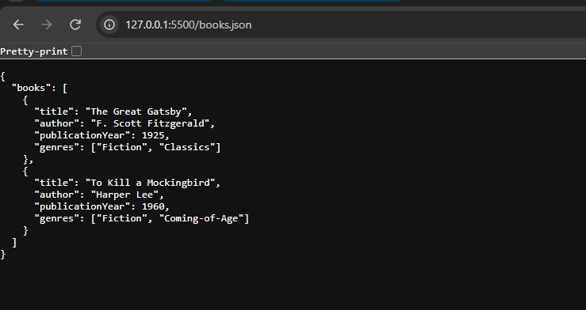
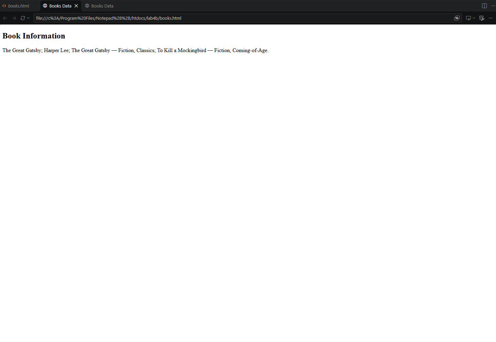
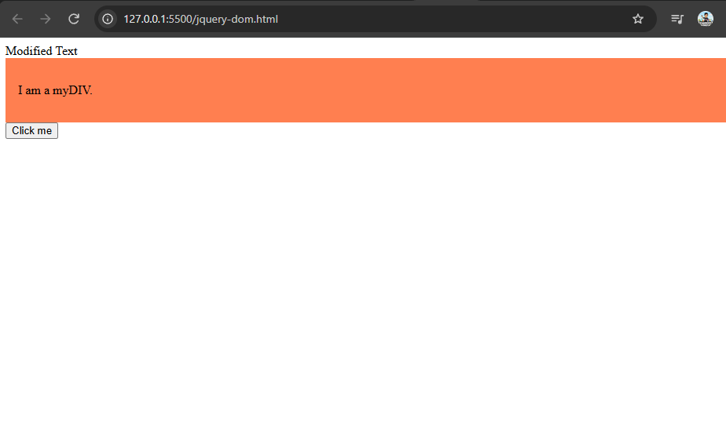
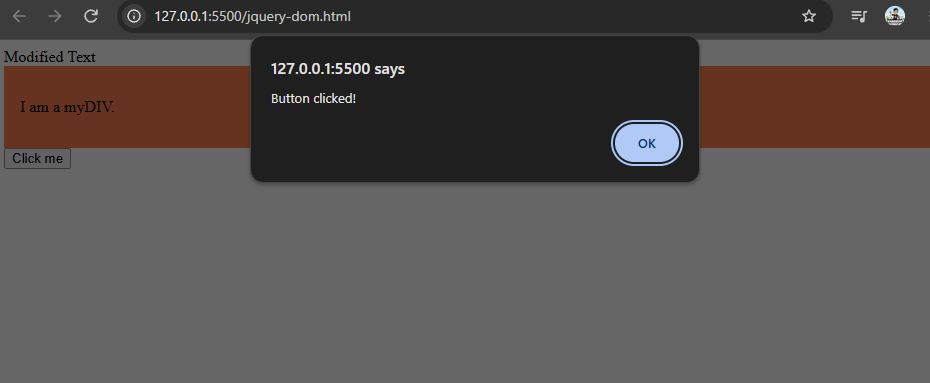

# bic21203-lab4b-JSON-and-jQuery

# BIC21203 - Web Development Lab 4b (JSON & jQuery)
**Name:** Muhammad Khairi bin Jalil  
**Student ID:** AI240009  
**Section:** 4

## Overview
This repository contains the completed tasks for Lab 4b, focusing on JSON data structure, the native JavaScript `fetch()` API and DOM manipulation using jQuery 4.0.0.

## Files Included
1. `books.json` - Dataset of book information.
2. `books.html` - Uses native JavaScript to fetch and display the JSON data.
3. `jquery-dom.html` - Demonstrates DOM manipulation using jQuery.

## Setup Instructions
To run this project locally, you must bypass browser CORS restrictions. CORS prevents JavaScript running on one domain from reading data or API responses from a different origin unless the receiving server explicitly permits it.
1. Open this repository folder in **Visual Studio Code**.
2. Install the **Live Server** extension.
3. Right-click on `books.html` (or `jquery-dom.html`) and select **"Open with Live Server"**.
4. The page will open in your browser via a local server such as ( `http://127.0.0.1:5500/...`), ensuring the `fetch()` command executes successfully. Do not open the files directly using the `file://` protocol.

## Screenshots

### Question 1: books.json

### Question 2: books.html Output

### Question 3: jquery-dom.html Output

